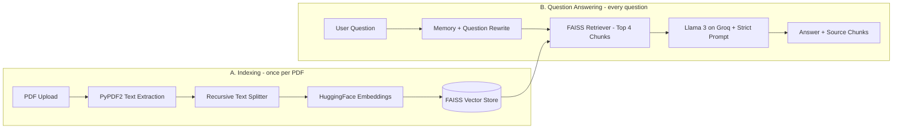

<div align="center">

# 📚 PagePilot

### Domain-Specific RAG Chatbot with Source Grounding and Memory

*Chat with any PDF. Get answers only from the document, with the exact sources shown.*


</div>

---

## 📖 About the Project

Large PDFs such as notes, books and reports take hours to read, and normal chatbots often **make up answers** (hallucination). **DocuChat AI** solves this with a **Retrieval-Augmented Generation (RAG)** pipeline:

1. Your PDF is split into small chunks and stored in a vector database.
2. For every question, only the **most relevant chunks** are retrieved.
3. The LLM answers **strictly from those chunks**. If the answer is not in the document, it says: *"I cannot find this in the document."*
4. The exact chunks used are shown below each answer, so you can verify it.

---

## ✨ Features

| Feature | Description |
|---|---|
| 📎 **PDF Upload** | Upload any text-based PDF from the sidebar |
| ✂️ **Smart Chunking** | `RecursiveCharacterTextSplitter` (250 characters, 50 overlap) with page numbers kept |
| 🧠 **Semantic Search** | HuggingFace `all-MiniLM-L6-v2` embeddings stored in a FAISS index |
| 💬 **Conversation Memory** | `ConversationBufferMemory` understands follow-up questions |
| 📚 **Source Grounding** | Expander under every answer shows the exact chunks and page numbers |
| 🛡️ **Anti-Hallucination Prompt** | Model must reply *"I cannot find this in the document."* when context has no answer |
| 🎨 **Modern UI** | Chat bubbles, stats panel, suggested questions, and chat download |

---

## 🏗️ Architecture



---

## 🛠️ Tech Stack

| Layer | Technology |
|---|---|
| Language | Python |
| Interface | Streamlit |
| PDF Reading | PyPDF2 |
| Orchestration | LangChain (`ConversationalRetrievalChain`) |
| Embeddings | HuggingFace `sentence-transformers/all-MiniLM-L6-v2` |
| Vector Database | FAISS |
| LLM | Llama 3 through ChatGroq |
| Memory | `ConversationBufferMemory` |

---

## 📁 Project Structure

```
docuchat-ai/
├── app.py                  Main Streamlit application
├── requirements.txt        Python dependencies
├── README.md               Project documentation
├── .gitignore              Keeps secret keys out of Git
├── .streamlit/
│   └── secrets.toml        Your Groq API key (NOT uploaded to GitHub)
└── screenshots/            App screenshots used in this README
```

---

## 🚀 Getting Started

### 1. Prerequisites

- Python **3.10, 3.11 or 3.12**
- A free **Groq API key** from [console.groq.com](https://console.groq.com)

### 2. Clone the repository

```bash
git clone https://github.com/[username]/[repo-name].git
cd [repo-name]
```

### 3. Create a virtual environment

**Windows**
```bash
python -m venv venv
venv\Scripts\activate
```

**Mac / Linux**
```bash
python3 -m venv venv
source venv/bin/activate
```

### 4. Install dependencies

```bash
pip install -r requirements.txt
```

The first install takes a few minutes because PyTorch is downloaded.

### 5. Add your Groq API key

The key is **never written inside `app.py`**. Use any one of these options:

**Option A: Streamlit secrets (recommended)**

Create the file `.streamlit/secrets.toml`:

```toml
GROQ_API_KEY = "gsk_your_key_here"
```

**Option B: Environment variable**

Windows (PowerShell):
```powershell
$env:GROQ_API_KEY = "gsk_your_key_here"
```

Mac / Linux:
```bash
export GROQ_API_KEY="gsk_your_key_here"
```

**Option C: Type it in the app**

If no key is found, the sidebar shows a password box where you can paste it.

### 6. Run the app

```bash
streamlit run app.py
```

Open **http://localhost:8501** in your browser.

---

## 💡 How to Use

1. Upload a PDF in the sidebar.
2. Click **🚀 Process Document** and wait for indexing to finish.
3. Ask questions in the chat box, or click a suggested question.
4. Open **📚 View sources** under any answer to see the exact text it was based on.
5. Use **Clear Chat History** or **Download Chat** from the sidebar.

---

## 📸 Screenshots


| Home Screen | Chat with Sources |
|---|---|
|  |  |

*Add your own screenshots in the `screenshots/` folder.*

---

## ⚙️ Configuration

You can change these values at the top of `app.py`:

| Setting | Default | Meaning |
|---|---|---|
| `GROQ_MODEL_NAME` | `llama-3.3-70b-versatile` | Groq model used for answers |
| `EMBEDDING_MODEL_NAME` | `all-MiniLM-L6-v2` | Embedding model |
| `CHUNK_SIZE` | `1000` | Characters per chunk |
| `CHUNK_OVERLAP` | `200` | Characters shared between chunks |
| `TOP_K_CHUNKS` | `4` | Chunks retrieved per question |

---

## 🧪 Evaluation

| Metric | How it was checked | Result |
|---|---|---|
| Answer accuracy | Manual check on 10 questions | [8/ 10 ] |
| Source correctness | Answer matches the shown chunk | [9/ 10 ] |
| Out-of-scope test | Unrelated question returns "I cannot find this in the document." | [Pass] |
| Average response time | Seconds per answer | [ 5 sec ] |

---

## 🩺 Troubleshooting

| Problem | Fix |
|---|---|
| `ImportError` for `ConversationalRetrievalChain` | Run `pip install "langchain<1.0" "langchain-community<1.0"` |
| `streamlit` is not recognized | Activate the virtual environment again |
| Model decommissioned or not found | Change `GROQ_MODEL_NAME` to a current model on console.groq.com |
| "No extractable text found" | The PDF is scanned. Use a PDF with selectable text |
| Windows blocks `torch_python.dll` | Turn off Smart App Control, or run on another laptop |
| Invalid API key | Re-copy the key without extra spaces |

---

## ⚠️ Limitations

- Scanned or image-only PDFs are not supported (no OCR).
- Tables and images inside PDFs are not understood.
- Answer quality depends on chunk size and how clearly the PDF is written.

---

## 🔮 Future Scope

- Support for multiple PDFs, Word and PowerPoint files
- OCR for scanned documents
- Hindi and multi-language support
- Answer highlighting inside the original PDF page

---


## 📄 License

This project is created for educational purposes. Licensed under the [MIT License](LICENSE).

---

<div align="center">

If you found this project useful, please give it a ⭐ on GitHub.

</div>
